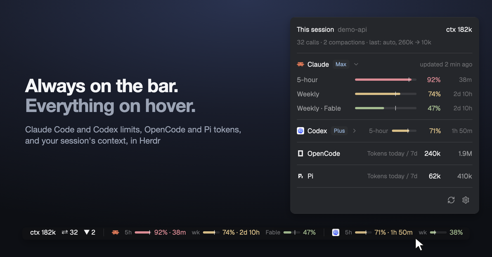
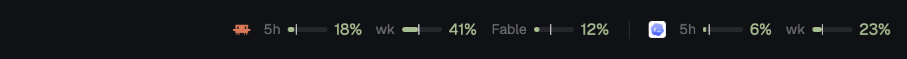
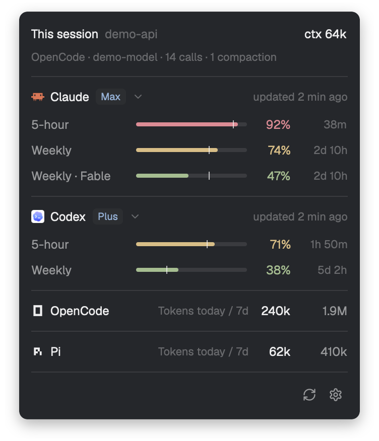
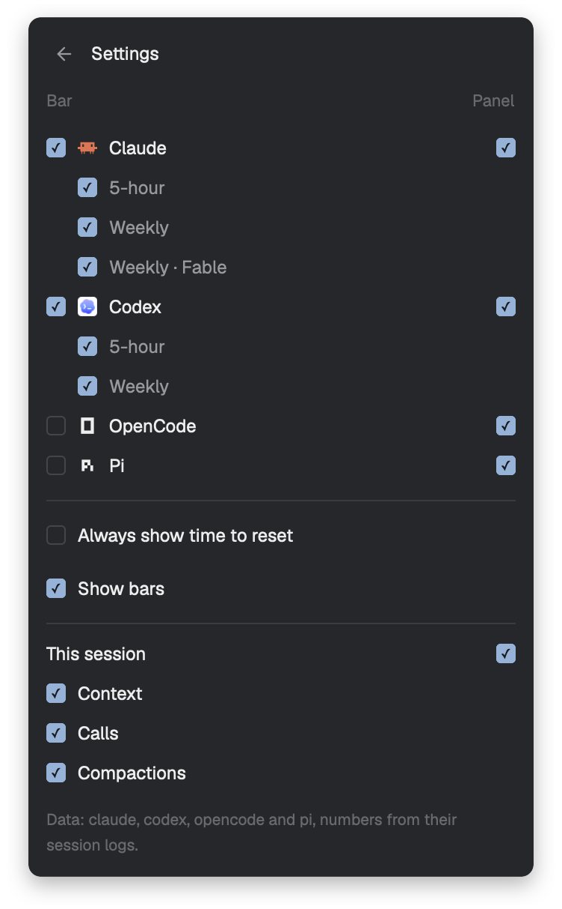
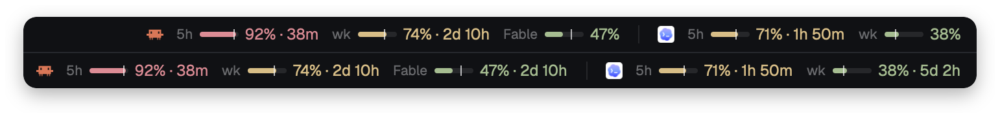
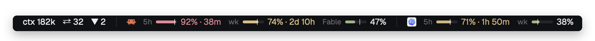

<p align="center">
  
</p>

<h1 align="center">Usage limits for Herdr</h1>

<p align="center"><strong>Know how much Claude Code and Codex you have left, and what OpenCode and Pi have spent, without leaving your agents.</strong></p>

<p align="center">
  <a href="LICENSE"></a>
  <a href="https://herdr.dev/mods"></a>
  
  
</p>

<p align="center">
  <a href="#install">Install</a> · <a href="#read-the-bar">Read it</a> · <a href="#hover-for-everything">Hover</a> · <a href="#choose-what-the-bar-shows">Settings</a> · <a href="#what-it-runs">What it runs</a> · <a href="RECIPE.md">Recipe</a>
</p>

<br>

See how much Claude Code and Codex you have left, right in Herdr's status bar:

- **Your limits:** 5-hour, weekly and per-model, each with a bar and a percent.
- **Everything on hover:** rest the pointer on the limits for the full picture.
- **Your current session:** how full the context is, how many messages you've sent, how many times it was compacted.
- **OpenCode and Pi:** the tokens they used today and over the last 7 days. They have no limits to show.

It asks your own `claude`, `codex` and `opencode` CLIs and reads Pi's session files, so there is no API key to add and no model usage to pay for.

## Read the bar

<p align="center">
  
</p>

- **The bar** is how much of the limit you've used.
- **The tick** is how much of the time has passed. Bar past the tick? You're using it up too fast.

<div align="center">

| 🟢 Under 70% | 🟡 70–89% | 🔴 90% and up |
|:---:|:---:|:---:|
| `41%` | `74% · 2d 10h` | `92% · 38m` |

</div>

From amber on, you also see the time left until the limit resets.

## Hover for everything

<p align="center">
  
</p>

Rest the pointer on the limits. The panel shows every limit and when it resets. Rest it on a
limit to see what its tick means in numbers. ↻ refreshes, ⚙ opens the settings.

Click a provider's name to fold it to one line: its tightest limit, with the bar, percent
and time to reset. Click again to open it. Everything starts open, and a fold is
remembered. An arrow beside the name shows while the pointer is on it, and always on a
folded line or when the panel holds three providers or more.

OpenCode and Pi get one line each: `Tokens today / 7d`, with both numbers. They don't
fold. One you haven't used in 7 days isn't shown.

The block at the top is the session in the terminal you're focused on, and it changes
when you switch terminals:

- **Context:** how much of it is filled. Codex shows a percent. Claude Code, OpenCode and Pi show tokens, because their session records don't say how big the window is.
- **Calls:** how many messages you've sent.
- **Compactions:** how many times the conversation was compacted. Claude Code and OpenCode, for now.

For OpenCode and Pi the second line also names the agent and the model: `Pi · demo-model · 2 calls`.

## Choose what the bar shows

<p align="center">
  
</p>

Click ⚙ in the panel. Each provider has two boxes: the left one, under **Bar**, is about
the bar; the right one, under **Panel**, is about the panel. They are separate, and by
default the panel still shows everything. "This session" has a Panel box too. A provider
on neither the bar nor the panel isn't asked, and the session isn't read while its block
is out of the panel and none of its numbers is on the bar. Every choice, and every fold, is
remembered across restarts.

- **Claude, Codex and their limits** are on by default. Untick what you don't watch.
- **OpenCode and Pi** put today's tokens on the bar: `today 240k`. They're off the bar by default, unless no provider with limits has any numbers; then they're on.
- **Always show time to reset** adds the time to every limit, green ones too.
- **Show bars** keeps a bar beside each limit. Untick it for numbers only.
- **This session** puts the numbers on the bar: `ctx` for context, `⇄` for calls, `▼` for compactions.

<p align="center">
  
</p>

<p align="center">
  
</p>

## It doesn't guess

- **A failing provider says so.** Offline or signed out, it shows a dim `!` and keeps its last good reading, dimmed, with its age.
- **Old numbers look old.** Anything over 15 minutes old is dimmed.
- **A passed reset shows `—`** until the next reading, never a made-up 0%.
- **Codex's session log is only a fallback.** It's marked as a past reading, never as live.
- **No session rather than the wrong one.** OpenCode and Pi don't say which session a terminal shows, so the mod ties them by folder and start time, and shows nothing when that isn't certain. With one copy of the agent in the folder, `/new` takes the block away. OpenCode's then stays away until you restart it, as it does after another OpenCode wrote in that folder. Pi's is away whenever another session in the folder was written after the one this Pi started with: while another Pi writes there (it comes back at this Pi's next reply), and after `/new` (until Pi is restarted). Right after OpenCode compacts, the block isn't shown until its next reply, as OpenCode itself has no count then. Two gaps are left: an OpenCode that hasn't sent anything since it started can show a session another short-lived OpenCode wrote in that folder, until its own first message; and with several Pi in one folder, a terminal whose Pi did `/new` keeps showing that terminal's previous session, because nothing on disk tells that apart from another Pi writing.
- **A failing token count says so too.** It keeps its last good numbers, dimmed.
- **Narrow window?** Bars go first, then labels, then the time on calm windows. Percents and providers stay.

## Install

Ask your Herdr agent to add this repository:

```text
Add the Herdr mod github.com/nozikov/herdr-usage-limits to my status bar
```

Or by hand, on macOS or Linux, with the `claude` or `codex` CLI signed in, or OpenCode
or Pi installed (OpenCode's session block also needs `sqlite3`):

```sh
git clone https://github.com/nozikov/herdr-usage-limits.git
cp -R herdr-usage-limits/mods/usage-limits ~/.config/herdr-app/mods/
herdr-app do layout.clone '{"name":"main","as":"my-main"}'
```

Then, in `~/.config/herdr-app/layouts/my-main.json`, replace the `status` block with
this row:

```json
{ "id": "status-row", "type": "row", "size": { "px": 28 }, "resizable": false, "children": [
  { "id": "status", "type": "block", "size": { "weight": 1 }, "content": { "mod": "workspace-status" } },
  { "id": "usage-limits", "type": "block", "size": { "weight": 2.2 }, "min": 130,
    "content": { "mod": "usage-limits" } } ] }
```

Give the block more weight if you want the bars to stay when a window gets tight.

## What it runs

- `sh`, your `claude` CLI and your `codex` CLI, each briefly, every 5 minutes. They use their own sign-ins and talk to Anthropic and OpenAI. The mod makes no network requests itself.
- `opencode stats --days 0 --json` and `opencode stats --days 7 --json`, every 5 minutes, for OpenCode's tokens. Their reply holds counts, costs, model and tool names and dates, no message text; it reaches the mod whole, and the mod uses its token numbers only.
- `hc`, to find the agent in the focused terminal, `lsof`, to find Codex's open session file, and `ps` and `lsof`, to find an OpenCode or Pi process's folder and start time. `ps` also lists your processes, to count the copies of that agent in the folder; their names and arguments stay on your machine.
- It reads no token or credential file.
- It reads the focused session's log (`~/.claude/projects/`, `~/.codex/sessions/`), which holds your conversation. `helpers/session.sh` passes on numbers only. `~/.codex/sessions/**/*.jsonl` is also the fallback for Codex's limits.
- For OpenCode's session it reads OpenCode's database (`$XDG_DATA_HOME/opencode/opencode.db`, by default `~/.local/share/opencode/opencode.db`) with `sqlite3`, read-only. For Pi it reads Pi's session files (`~/.pi/agent/sessions/`): the focused session's, and those written in the last 8 days for the tokens. Both hold your conversation. `helpers/session.sh` and `helpers/pi-spend.sh` pass on only numbers (counts and times) and a model id. It never runs `pi`.
- It sends no prompt and starts no turn, so it uses no model time.
- It changes no Claude Code, Codex, OpenCode or Pi settings.

> [!NOTE]
> `get_usage` is an internal Claude Code interface, checked on 2.1.317. If an update changes it, Claude shows `!` with the error instead of numbers.

## Develop

```sh
rsync -a --delete mods/usage-limits/ ~/.config/herdr-app/mods/usage-limits/
npm test                                    # node --test, no dependencies
herdr-app check ~/.config/herdr-app/mods/usage-limits
```

Copy the mod, don't symlink it: Herdr won't load icons through a link that leaves its
home, so ↻ and ⚙ would be blank. It doesn't hot-reload either: after copying, switch
layouts away and back (`herdr-app do layout.switch '{"name":"main"}'`, then your layout).

[RECIPE.md](RECIPE.md) is the brief to build the mod from scratch. A new provider is
one file in `providers/` plus its helper; `kind: "spend"` makes it count tokens instead
of limits. A new agent for "This session" is a mode in `helpers/session.sh` and its
Herdr name in `AGENTS` in `main.js`.

## Credits

The approach for Claude's `get_usage` comes from
[jmalicki/herdr-mod-ai-usage](https://github.com/jmalicki/herdr-mod-ai-usage) (MIT).
Screenshots are the real mod in a demo window, with sample numbers.
The panel's icons are from [Lucide](https://lucide.dev) (ISC).

## License

[MIT](LICENSE)
