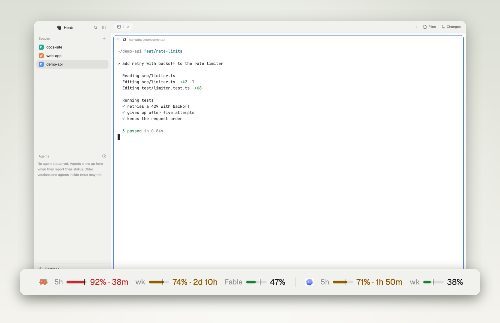
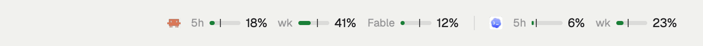
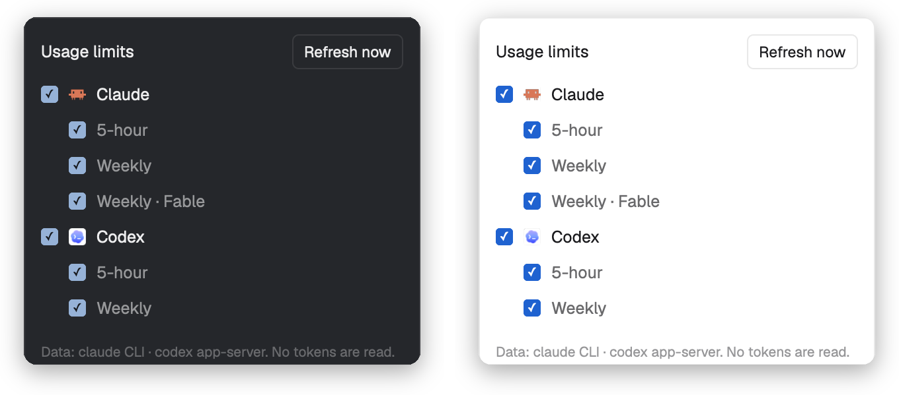

<p align="center">
  <picture>
    <source media="(prefers-color-scheme: dark)" srcset="assets/hero-dark.png">
    
  </picture>
</p>

<h1 align="center">Usage limits for Herdr</h1>

<p align="center"><strong>Know how much Claude Code and Codex you have left, without leaving your agents.</strong></p>

<p align="center">
  <a href="LICENSE"></a>
  <a href="https://herdr.dev/mods"></a>
  
  
</p>

<p align="center">
  <a href="#install">Install</a> · <a href="#read-it-at-a-glance">Read it</a> · <a href="#what-it-runs">What it runs</a> · <a href="RECIPE.md">Recipe</a>
</p>

<br>

Every limit window your subscriptions report, in the status bar: 5-hour, weekly and
per-model weekly. It asks your own `claude` and `codex` CLIs, so there is no API key
to add, no token to read and no model usage to pay for.

## Read it at a glance

<p align="center">
  <picture>
    <source media="(prefers-color-scheme: dark)" srcset="assets/states-dark.gif">
    
  </picture>
</p>

| You see | It means |
|---|---|
| **The bar** | How much of the window you've used |
| **The tick** | How much of the window's time has passed. A bar past its tick means you're burning faster than the window allows |
| **Green** | Under 70% |
| **Amber** | 70–89%, and the time to reset appears: `74% · 2d 10h` |
| **Red** | 90% and up: `92% · 38m` |

Hover a provider for its plan, when it last updated, and each window's reset time and
pace (`ahead`, `on pace`, `under`).

## Show only what you watch

<p align="center">
  
</p>

Click the limits to choose providers and windows. A new window or a CLI you install
later shows up by itself, and hidden providers aren't fetched at all.

## It doesn't guess

- **A failing provider says so.** Offline or signed out, it shows a dim `!` and keeps its last good reading, dimmed, with its age.
- **Old numbers look old.** Anything over 15 minutes old is dimmed.
- **A passed reset shows `—`** until the next reading, never a made-up 0%.
- **Codex's session log is only a fallback.** It's marked as a past reading, never as live.
- **Narrow window?** Bars go first, then labels. Percents and providers stay.

## Install

Ask your Herdr agent to add this repository:

```text
Add the Herdr mod github.com/nozikov/herdr-usage-limits to my status bar
```

Or by hand, on macOS or Linux, with the `claude` or `codex` CLI signed in:

```sh
git clone https://github.com/nozikov/herdr-usage-limits.git
cp -R herdr-usage-limits/mods/usage-limits ~/.config/herdr-app/mods/
herdr-app do layout.clone '{"name":"main","as":"my-main"}'
```

Then, in `~/.config/herdr-app/layouts/my-main.json`, replace the `status` block with
this row:

```json
{ "id": "status-row", "type": "row", "size": { "px": 28 }, "resizable": false, "children": [
  { "id": "status", "type": "block", "size": { "weight": 1 }, "content": { "mod": "workspace-status" } },
  { "id": "usage-limits", "type": "block", "size": { "weight": 2.2 }, "min": 130,
    "content": { "mod": "usage-limits" } } ] }
```

Give the block more weight if you want the bars to stay when a window gets tight.

## What it runs

- `sh`, your `claude` CLI and your `codex` CLI, each briefly, every 5 minutes. They use their own sign-ins and talk to Anthropic and OpenAI. The mod makes no network requests itself.
- It reads no token or credential file. It reads `~/.codex/sessions/**/*.jsonl` only as a fallback.
- It sends no prompt and starts no turn, so it uses no model time.
- It changes no Claude Code or Codex settings.

> [!NOTE]
> `get_usage` is an internal Claude Code interface, checked on 2.1.317. If an update changes it, Claude shows `!` with the error instead of numbers.

## Develop

```sh
ln -s "$PWD/mods/usage-limits" ~/.config/herdr-app/mods/usage-limits
npm test                                    # node --test, no dependencies
herdr-app check ~/.config/herdr-app/mods/usage-limits
```

Herdr doesn't hot-reload a symlinked mod: after editing, switch layouts away and back
(`herdr-app do layout.switch '{"name":"main"}'`, then your layout).

[RECIPE.md](RECIPE.md) is the brief to build the mod from scratch. A new provider is
one file in `providers/` plus its helper.

## Credits

The approach for Claude's `get_usage` comes from
[jmalicki/herdr-mod-ai-usage](https://github.com/jmalicki/herdr-mod-ai-usage) (MIT).
Screenshots are the real mod in a demo window, with sample numbers.

## License

[MIT](LICENSE)
