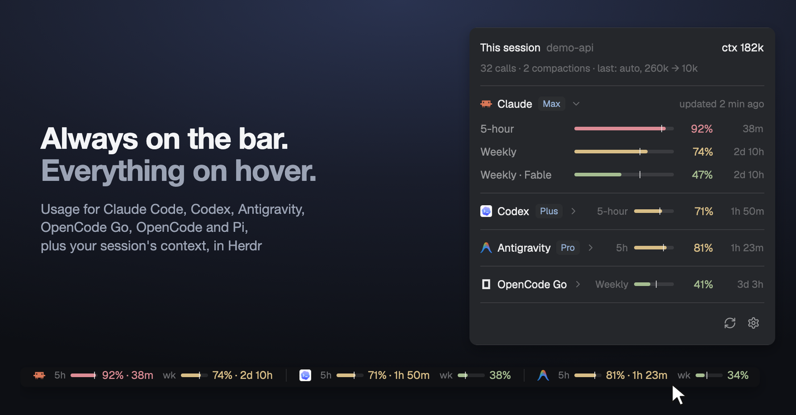

# Usage limits

Your Claude Code and Codex subscription limits in the Herdr status bar, always
in view: every limit window each one reports (5-hour, weekly, per-model weekly
such as Fable), with a bar, a pace tick, the percent used and, when it gets
tight, the time to reset. OpenCode and Pi, which have no limits, show the tokens
they spent today and over 7 days. Hover it for the details and to choose what shows
on the bar and in the panel. It never reads a token.



## What you see

- A block at the right end of the status bar (28px high, `chrome` background,
  1px `border` top line, text 11.8px `muted`), sized by weight next to
  `workspace-status`.
- One group per provider, Claude first, then Codex; a 1×14px `border` divider
  between groups. A group: the program icon (`icons/claude.svg`,
  `icons/codex.svg`, 13px), then one segment per window:
  - a dim label (10.5px): `5h`, `wk`, `Fable`, …;
  - a 30×4px bar, track `border`, fill = percent used;
  - a 1×8px `foreground` tick at 75% opacity = how much of the window's time
    has passed (pace);
  - the percent in its color.
- OpenCode and Pi come after Codex, when they are on the bar: the icon
  (`icons/opencode.svg`, `icons/pi.svg`), a dim `today` and the number
  (`today 240k`). No bar, tick or percent.
- Colors by percent: under 70 `ansi2` (green), 70–89 `ansi3` (amber), 90+
  `ansi1` (red). Amber and red also color the text and add the time to reset:
  `92% · 38m`, `74% · 2d 10h`. With "Always show time to reset" ticked, green
  windows add it too.
- Hover the limits: one panel above the bar, the only way in (no click), right-aligned, after 350 ms. Each
  provider with its plan as a small badge and "updated N min ago", then one
  line per window: its long name, a bar with the tick, the percent and the
  time to reset. The percent always wears its color, green included. Resting
  on a line shows what its tick means, in its own numbers (`Tick: 66% of the
  time has passed. You've used 74%, so you're on pace.`). By
  default it shows everything, whatever is hidden from the bar. A failing
  provider shows why in red and its last reading dimmed, with its age. ↻
  refreshes.
- A click on a provider's header folds it to one line: icon, name, plan, then
  on the rows' columns the dim long name of its tightest window (highest
  percent, ties to the sooner reset, a passed reset only if it's the only one),
  a short bar with the tick, the percent and the time left. Folded and failing:
  `! ` and the reason in red where the window's name goes, the reading dimmed.
  A chevron sits right after the name and plan: always on a folded line and
  with three providers or more, else only under the pointer, so a Claude +
  Codex panel shows none at rest. Everything starts open.
- OpenCode and Pi are one line each in the same list: icon, name, a dim
  `Tokens today / 7d`, today's number in the percent column, the 7-day number in
  the time column. They never fold. Failing: `! ` and the reason in red in place
  of the label, the last numbers dimmed. Installed but unused for 7 days: not
  shown, on the bar or in the panel.
- The panel opens with "This session", for the agent in the focused terminal:
  context (a bar and percent if the window is known, else tokens), calls (the
  person's messages), compactions and the last one's size. For OpenCode and
  Pi the second line starts with the agent and its model
  (`OpenCode · demo-model · 4 calls · 1 compaction`, `Pi · demo-model · 2 calls`);
  Claude's and Codex's stay as they were.
  Nothing else focused, no block.
- Left boxes are about the bar, right boxes about the panel; a provider on
  neither isn't fetched, and ticking it again fetches it at once. The session
  isn't read while its block is out of the panel and none of its numbers is on
  the bar; ticking one of those again reads it at once. Session
  numbers join the bar when ticked (`ctx 24%`, `⇄ 32`, `▼ 2`), off by default.
  OpenCode and Pi are off the bar by default, unless no provider with limits
  has a reading with a window (its current one or its last good one); that
  default is worked out live, waits until every fetched limits provider has
  answered once, and an explicit click always wins.
- ⚙ swaps the panel, in place, to settings: a header line, `Bar` on the left
  and `Panel` at the right edge; a row per provider with a bar box on the left
  and a panel box at the right end, and, under it, a bar box per window; for
  OpenCode and Pi the left box is "today's tokens on the bar"; "Always show
  time to reset" (off by default); "Show bars" (on by default, off leaves
  numbers only); "This session" with its own panel box, and its rows for the
  bar; a footnote on where data comes from. ← swaps back, and it opens on
  limits again next time. ↻ has a 30 s cooldown.

## How it behaves

- Not tied to agent status (working, blocked, done, idle): limits are
  per account, not per agent.
- Fetches each provider on the bar or in the panel at start and every 5 minutes; redraws every
  minute so countdowns and pace move.
- A provider whose CLI isn't installed is left out of the bar, greyed in the
  settings, and re-checked hourly. OpenCode counts as installed when the
  `opencode` CLI is on PATH; Pi when `~/.pi/agent/sessions` exists. One that is
  installed but fails (offline, not signed in, CLI changed) stays with a dim `!`
  and keeps its last good reading, dimmed, with its age in the panel. Before the
  first reading: `…`. OpenCode or Pi installed but unused for 7 days is greyed in
  the settings with "no use in 7 days".
- Readings older than 15 minutes are dimmed (55% opacity).
- A window whose reset time has passed shows `—` until the next reading: never
  a guessed 0%.
- Narrow window: bars go first, then labels; percents and providers stay.
- Everything hidden: a small gauge icon remains, and hovering it opens the panel
  as usual. With nothing for the panel (no CLI installed, or the session and
  every provider taken out of it), the panel opens on settings.
- Choices are opt-out lists, so a new window (another model limit) or a CLI
  installed later shows up by itself. Folds and bar/panel choices are stored
  and survive a restart; only explicit clicks are stored.

## Built from

- Layout: clone `main` (`herdr-app do layout.clone '{"name":"main","as":"my-main"}'`)
  and replace the `status` block with a row:

  ```json
  { "id": "status-row", "type": "row", "size": { "px": 28 }, "resizable": false, "children": [
    { "id": "status", "type": "block", "size": { "weight": 1 }, "content": { "mod": "workspace-status" } },
    { "id": "usage-limits", "type": "block", "size": { "weight": 2.2 }, "min": 130,
      "content": { "mod": "usage-limits" } } ] }
  ```

  Optional presets in `content.props`: `{ "hidden": ["codex"],
  "hiddenWindows": ["claude:session"], "showResetTime": true,
  "sessionOnBar": ["context", "calls", "compactions"], "panelHidden": ["session"],
  "folded": ["claude"], "spendOnBar": { "opencode": true } }` (used until the person
  changes anything in the settings). `hidden` and `hiddenWindows` mean "hidden from
  the bar"; `panelHidden` lists providers, and `"session"`, left out of the panel;
  `folded` lists folded providers; `spendOnBar` holds an explicit bar choice per
  spend provider. Every key is optional, so older prefs and presets read as before.
- `mods/usage-limits/`:
  - `main.js`: the View, the one class. It keeps the state (panel, pointer,
    focused terminal, session read, fetches in flight) and calls the host:
    `shared`/`setShared` (`usage-limits.state`, `usage-limits.prefs`,
    `usage-limits.refresh`), `cx.timer.every(60 s)`, `focused()`, `theme()`.
    At most 12 methods, enforced by eslint.
  - `actions.js`: what clicks and the pointer do (fold, toggles, refresh,
    choose or drop a Codex session, hover). Toggles read the prefs at click
    time, not the ones the panel was drawn with, so two clicks before a redraw
    both count.
  - `ui/`: drawing only, from data and actions: `bar.js` (the status bar and
    the `HoverCard`; keep `close_delay` at 300 ms or more, it's how the pointer
    reaches the panel), `card.js` (limit groups, folds, spend lines),
    `panel.js` (the panel, the session block and picker), `settings.js`,
    `kit.js` (colors, bars, icons). No `herdr` import.
  - `io/`: `sh.js` runs a helper with `sh`, and on Windows, where Git puts
    `git` on PATH but not its `sh`, with the `sh.exe` next to `git
    --exec-path`, kept for later calls; a timeout is not retried.
    `helpers.js` runs a provider's helper (spend helpers with a 15 s deadline,
    as `pi-spend.sh` has none of its own) and `session.sh` (15 s; a timeout is
    "no session").
  - `providers/claude.js`, `providers/codex.js`, `providers/opencode.js`,
    `providers/pi.js`: `{ id, name, icon, helper, parse(text, now) → Report }`;
    OpenCode and Pi add `kind: "spend"`, and their report has no windows and
    carries `spend: { today, week }`; it goes through the same state path, so
    "not installed", "failing with a last good reading" and "stale" work as for
    limits. `providers/index.js` lists them
    in order. A new provider is one more file there plus its helper.
  - `icons/`: the mod's own (`gauge`, `refresh`, `gear`, `back`,
    `chevron-down`, `chevron-right`); the agents' icons come from Herdr's.
  - `lib/`: pure, tested with `node --test`: `report.js` (shapes below),
    `format.js` (time, colors, pace), `prefs.js` (opt-out lists, flags, panel,
    folds, spend on the bar), `session.js` (session line and block),
    `session-binding.js` (an explicit Codex choice), `state.js` (next provider
    state), `fetch-state.js` (what a helper's exit means), `settings.js` (the
    settings rows), `view.js` (segments, panel and bar models, tightest
    window, the spend default, what is fetched, density), `mod.js`.
  - Layers, enforced by eslint: `lib/` and `providers/` import neither the
    host nor `ui/`; `ui/` doesn't import `herdr`, `io/` or `actions.js`; `io/`
    and `actions.js` don't draw.
  - `helpers/claude-usage.sh`: runs `claude -p --safe-mode
    --no-session-persistence --input-format stream-json --output-format
    stream-json --verbose`, sends `{"type":"control_request",…,"request":
    {"subtype":"get_usage","skip_behaviors":true}}`, prints the
    `control_response` line (`rate_limits.limits[]`: `kind` `session` /
    `weekly_all` / `weekly_scoped` + `scope.model.display_name`, `percent`
    0–100, `resets_at` ISO 8601), kills the CLI. `--safe-mode` keeps hooks,
    MCP servers and customizations out of that run; it sends no prompt and
    starts no turn.
  - `helpers/codex-limits.sh`: runs `codex app-server`, JSON-RPC
    `initialize` / `initialized` / `account/rateLimits/read`, prints the
    `"id":2` line (`primary`/`secondary`: `usedPercent`, `windowDurationMins`,
    `resetsAt` epoch s), kills it. Falls back to the newest `rate_limits`
    event in `~/.codex/sessions` (14 days).
  - Both helpers: exit 0 with one JSON line, 127 when the CLI isn't found,
    1 on any other failure; ~15 s timeout. `HERDR_USAGE_CLAUDE_BIN` /
    `HERDR_USAGE_CODEX_BIN` override the binaries.
  - `helpers/opencode-spend.sh`: runs `opencode stats --days 0 --json` and
    `--days 7 --json` at once, stdin closed, and prints
    `{"today":…,"week":…}` with both replies whole, each cut from its first line
    starting with `{` (a notice printed before the JSON goes). Tokens = `input +
    output + reasoning + cache.read + cache.write`; `input` and `output` must be
    numbers, `reasoning` and `cache` may be missing (0), and a field of another
    type makes it a failure ("No stats from OpenCode"), never 0. `--days 7` is
    today and the six days before (opencode 2.2.5). Exit 127 when `opencode`
    isn't on PATH, 1 when a call fails, prints no JSON object or isn't done in
    10 s (TERM, then KILL). `HERDR_USAGE_OPENCODE_BIN` overrides the binary.
  - `helpers/pi-spend.sh`: prints `<ISO timestamp> <totalTokens>` per assistant
    reply in Pi's session files written in the last 8 days; `providers/pi.js`
    adds them up by local day (today, and today with the six days before).
    The reply's `usage` counts only when it is one of the message's own fields,
    never one inside a tool call's arguments. Never runs `pi`. Exit 127 when
    `~/.pi/agent/sessions` doesn't exist, 1 when that folder can't be read; a
    folder or file inside it that can't be read is left out and the rest
    counted. It has no deadline of its own: `io/helpers.js` runs every spend
    helper with a 15 s `exec` timeout.
  - `helpers/awk/`: the awk programs the helpers run; `json-field.awk` (a
    number after a key, and whether a key is one of a Pi message's own fields)
    is shared by `pi-spend.sh` and `session.sh`.
  - `helpers/opencode-db.sh session|spend`: reads `opencode.db` read-only
    through whichever storage adapters its tables call for.
  - `helpers/session.sh claude|codex|opencode|pi <pid>`: one line of numbers,
    `tokens=N calls=N`, plus `compactions=N` (Claude, OpenCode), `window=N`
    (Codex), `model=<id>` (OpenCode, Pi; only if it matches
    `[A-Za-z0-9._:/-]+`). Exit 0 with it, 1 when no session is certain; Codex:
    2 with JSON choices (session IDs and titles) when one must be picked, and
    after a pick the mod passes the thread ID and the process identity as
    third and fourth arguments. Claude's files: `CLAUDE_CONFIG_DIR`, else
    `%USERPROFILE%\.claude` when it exists, else `~/.claude`.
    OpenCode: top-level `session_v2` rows and `session_message` rows of
    `opencode.db`, through `sqlite3 -readonly`; context = the newest reply's
    `input + output + reasoning + cache.read + cache.write`. Pi:
    `~/.pi/agent/sessions/--<cwd with each /, \ and : as ->--/<start>_<id>.jsonl`
    (`/home/demo/a:b` is `--home-demo-a-b--`); context = the last reply's
    `input + cacheRead + cacheWrite`, its `usage` and `model` taken only from
    the message's own fields, never from a tool call's arguments.
  - Env overrides: `HERDR_USAGE_PI_HOME` (instead of `~/.pi`),
    `HERDR_USAGE_OPENCODE_DB` (instead of
    `${XDG_DATA_HOME:-~/.local/share}/opencode/opencode.db`),
    `HERDR_USAGE_SQLITE_BIN` (instead of `sqlite3`). Tests replace what is
    looked up about the process: `HERDR_USAGE_PROC_CWD`,
    `HERDR_USAGE_PROC_START` (epoch s) and `HERDR_USAGE_PROC_PEERS` (agents of
    that name in that folder, itself included).
- Approach for Claude's `get_usage`: credit to
  [jmalicki/herdr-mod-ai-usage](https://github.com/jmalicki/herdr-mod-ai-usage) (MIT).

## Shapes

- Window: `{ id, short, long, percent (0–100), resetsAt (epoch s | null),
  durationSec (s | null) }`.
- Report: `{ status: "ok" | "unavailable" | "error", message, plan,
  observedAt (epoch s), source, windows }`. A spend provider's ok report has
  no windows and carries `spend: { today, week }` (token counts; week is the
  last 7 days, today included). An error report may carry `fallback`, an
  older dated reading (Codex's session log); it becomes `lastGood` only when
  nothing fresher is known.
- ProviderState: `{ report: Report | null, lastGood: Report | null,
  installed: true | false | null }`; `report` is null when the CLI isn't
  installed (`installed: false`) or before the first answer.
- Session: `{ app, tokens, window | null, calls, compactions | null,
  last: { trigger, pre, post } | null }`, plus `model: string | null` for
  OpenCode and Pi, whose block names the agent and its model. `compactions`
  is null where the agent's log isn't known to record them, which is not 0.
- Prefs: as in the presets above, plus `showBars` (each limit has its bar
  when there's room; off, numbers only). Limits are opt-out lists, so anything
  new shows by itself; session numbers on the bar are opt-in. `showResetTime`:
  every window shows its time to reset, not only amber and red ones.

## Code

- No comments in code: a name, a constant, a small function, an assert
  message or a test says it; reasons that are about the platform live here.
- JavaScript is functions; the one class is the View Herdr requires.
- `npm test` runs the mod's tests, then the quality gate in `test/quality/`:
  eslint (size and complexity limits, no classes or `this` outside the View,
  the layers), jscpd (no copied code), shellcheck (POSIX `sh`), no comments
  in JS, shell, Python, SQL or awk, file sizes. `npm install` first.
- CI (`.github/workflows/ci.yml`) runs the same `npm test` on Linux and macOS
  for every pull request and every push to `main`; a pull request merges only
  when both pass.
- `mods/usage-limits/test/main.test.js` runs the real `main.js` over host
  stand-ins and compares what it draws and does, click by click, with
  `test/fixtures/main-snapshot.json`; `UPDATE_SNAPSHOT=1` rewrites it after a
  change meant to show. `view-before.json` is `cardModel`/`barModel` of the
  scenarios in `_view-scenarios.js` from the code before spend providers, and
  `view-before-extra.json` from the code at `19fda91`: the guard that a Claude
  + Codex user sees no change.

## What it runs and reads

- Runs `sh`, your `claude` CLI and your `codex` CLI, each briefly, every
  5 minutes. They use their own sign-ins and talk to Anthropic / OpenAI; this
  mod makes no network requests itself.
- Runs `opencode stats --days 0 --json` and `--days 7 --json` every 5 minutes.
  Their reply holds counts, costs, model and tool names, no message text; it
  reaches the mod whole, and the mod uses the token numbers only.
- Runs `hc`, `ps` and `lsof` to find the agent in the focused terminal, its
  folder and start time, and Codex's open session file. `ps` also lists the
  processes, names and arguments, to count the copies of an agent in a folder;
  that stays on the machine.
- Reads no token or credential file. Reads `~/.codex/sessions/**/*.jsonl`
  only as a fallback.
- Reads the focused session: Claude's and Codex's logs, OpenCode's database
  through `sqlite3`, read-only, and Pi's session files; Pi's files of the last
  8 days for its tokens. All of them hold the conversation. Only numbers
  (counts and times) and a model id leave `session.sh` and `pi-spend.sh`,
  except Codex's session picker, which passes session IDs and titles (never
  message text);
  `opencode stats`' reply reaches the mod whole (counts, costs, model and tool
  names, dates; no message text), and the mod uses its token numbers. Never
  runs `pi`.
- Sends no prompt and starts no turn: no model usage.
- Changes no Claude Code, Codex, OpenCode or Pi settings.

## Watch out

- `get_usage` is an internal Claude Code interface (verified on 2.1.317). If an
  update changes it, Claude shows `!` with the error instead of numbers.
- `svg()` and `image()` don't follow a symlink out of Herdr's home: icons of a
  symlinked mod draw blank, with no error in `herdr-app status`. Install by
  copying.
- A `HoverCard` sits above overlays and can't be closed from a script, so an
  overlay opened from it ends up underneath: keep settings inside it. It doesn't
  report closing either: `panelOnEnter` works that out when the pointer returns.
- The session must be the focused terminal's, never a guess by folder (two
  agents can share one). `hc get <terminal>` gives `foreground.pid`. Claude:
  `~/.claude/sessions/<pid>.json` has the `sessionId`. Codex: a child
  `app-server` of that pid holds the `rollout-*.jsonl` open (`lsof`).
- OpenCode and Pi hold no session file open, and Herdr doesn't say which
  session a terminal shows, so the tie is the process's folder
  (`/proc/<pid>/cwd`, else `lsof`) and start time (`ps -o etime=`), never the
  folder alone: two agents can share one. Pi: the session that started with
  the process (the file name's timestamp within 2 s of the process start) is
  shown only if no other session in that folder was written after it; a
  resumed session only when it is the single candidate and started before the
  process; several Pi processes in one folder are told apart by start time or
  not at all. OpenCode: exactly one top-level session of that folder updated
  since the process started, and one terminal client in that folder (no
  `opencode serve` is one, the background `opencode serve --service`
  included); else nothing.
- What that does, with one copy of the agent in the folder: `/new` takes the
  block away. OpenCode's stays away until the agent is restarted (two sessions
  updated since it started), as after any other writer in that folder. Pi's is
  away while another session in the folder was written after the one this Pi
  started with, and comes back once that one is the last written again: after
  another Pi wrote there, at this Pi's next reply; after `/new`, whose session
  is that other one, not before Pi restarts. The limit: with several Pi in
  one folder, a terminal whose Pi did `/new` keeps showing that terminal's
  previous session, because nothing on disk tells "this Pi did `/new`" from
  "another Pi wrote". Known risk left: an OpenCode client that has sent
  nothing yet can be shown a session another short-lived writer made in that
  folder (a client that came and went, `opencode run`, the desktop or web
  app), until its own first message makes two candidates.
- `lsof -Fn` writes a byte it won't print as `\xNN` (every non-ASCII byte
  under the C locale) and a backslash as `\\`: `session.sh` runs it under
  `LC_ALL=C` and undoes those two, so a Cyrillic folder is found; any other
  escape (a control character in the name) gives no session.
- Pi sessions are trees: after `/tree` the last reply in the file can be on
  another branch than the one on screen. Not handled.
- Pi is "installed" when `~/.pi/agent/sessions` exists, not when `pi` is on
  PATH: `pi` can be a shell function (a lazy nvm one) that `sh` can't see.
  OpenCode is installed when the `opencode` CLI is on PATH.
- OpenCode records a finished compaction as a `compaction` row in
  `session_message`; it is counted. Right after one, OpenCode has no token
  count until the next reply, and the block isn't shown in that gap. Pi's
  compactions aren't counted: none could be made to happen (the session was too
  small). Pi's source writes a `{"type":"compaction"}` line, and the helper
  drops the context after one until the next reply; that is unobserved.
- Pi's context is the last reply's input and cached tokens; Pi's own footer
  also counts the reply's output, so it reads slightly higher.
- `opencode stats` and `sqlite3` can hang: run them with stdin closed and a
  deadline.
- Folding: the `HoverCard` is anchored at the bottom and grows upward, so a
  fold moves the clicked header down by the height of its rows. A folded
  group takes no more room than its line, chosen over keeping invisible
  space under it: with little above the header (the top group), the card's
  top can drop below a still pointer and the card closes; hovering again
  opens it.
- A Claude turn with a server tool sums `usage` over all its requests, which
  doubles the context: read the last entry of `usage.iterations`.
- Claude's `last-prompt` marker repeats within a turn (65 for 19 messages): count
  `user` lines instead, leaving out tool results, meta, compact summaries and
  subagents. Its log has no context window; Codex's `token_count` does.
- Claude's resets land a fraction of a second before the minute
  (`13:59:59.6`): round to the minute, or the panel says 13:59.
- `sh missing.sh` exits 127 too; a test for "CLI not found" must also check
  the helper itself ran.
- Keep the CLI's input there until the reply and kill the CLI after it; a
  `sleep` holding a pipe makes every call last the sleep. Not through a FIFO:
  on Windows (Git sh) a native `claude.exe` never answers through `mkfifo`, and
  a FIFO reaches `codex` empty. Claude reads the request from a regular file
  (it answers a control request read before end of input, and `$!` stays the
  CLI's own pid in every `sh`, so the kill reaches it). Codex reads from a
  pipe held open until the answer is out (at most 15 s): `app-server` quits at
  end of input without answering, and once it has answered, end of input lets
  it exit by itself (2 s grace). The writer holds none of the helper's output,
  so it can't keep a caller waiting.
- Deadlines are a clock, not a count of rounds: Git Bash forks slowly, and 75
  rounds of 0.2 s ran to 20 s there.
- On Windows, Git sh's `$HOME` can be a network drive while Claude Code keeps
  its files under `%USERPROFILE%`: that wins when it has a `.claude` folder.
- Codex not installed is 127 even if old session logs exist, which would look
  like a reading. A logged snapshot is never a live reading: the provider is
  failing, and the snapshot is a dated candidate for "last good" only.
- Codex's session (`codex-session.py`): embedded servers live in the TUI
  itself, older versions used a child server, so both are looked up; the
  SQLite row of a thread can lag behind its rollout file; a last line still
  being written is skipped; some legacy logs emit `context_compacted` for the
  same record as `compacted`; top-level sources such as `cli` and `vscode`
  are plain strings, not JSON.
- `pi-spend.sh`: `find "$dir/"` with the trailing `/` enters the folder when
  it is a symlink; `find`'s own status is not used (one folder it can't enter
  would lose them all); only readable files reach `awk`, which stops at the
  first it can't open. ISO timestamps in UTC sort as text.
- Session files hold the conversation, JSON-escaped, so `\"role\"` in a text
  can't match the `"role"` a helper looks for.
- OpenCode's spend prefers the database to the CLI: a desktop app's PATH may
  not find an NVM-installed `opencode`. The temp views exist only in that
  read-only connection, and one transaction reads both stores from one
  snapshot. Spending counts paid compaction requests and subagents, unlike the
  session's context. `--days 7` is today and the six days before (its
  `range.from` on 2.2.5 is local midnight six days back).
- Herdr starts programs with your login environment; the CLIs must be on
  that PATH (or use the env overrides).
- Herdr doesn't hot-reload a mod folder that is a symlink; switch layouts
  away and back after editing.
- macOS and Linux only (`sh`). Local machine only, one account per CLI.
- Labels are English.

## Done when

- `npm test` in the repo passes (parsers on recorded replies, helpers with a
  fake CLI, formatting, prefs, bar model).
- `herdr-app check ~/.config/herdr-app/mods/usage-limits` passes.
- `sh helpers/claude-usage.sh` prints a `control_response` line in ~1–2 s and
  leaves no `claude` process behind; `sh helpers/codex-limits.sh` prints an
  `"id":2` line in ~1–2 s.
- `sh helpers/opencode-spend.sh` and `sh helpers/pi-spend.sh` print within a
  few seconds; `sh helpers/session.sh opencode|pi <pid>` gives the same context
  as the agent's own screen (Pi's footer a little higher, see above), and as
  many calls as the messages you sent in that session: count them yourself,
  neither agent shows the number.
- The bar shows the same numbers as Claude Code's `/usage` and Codex's
  `/status`.
- Hovering opens the panel above the bar and moving onto it keeps it open.
- Its session block matches the focused terminal, and changes with focus.
- ⚙ swaps it to settings; unticking Codex removes it from the bar and it
  stays removed after restarting Herdr. The same for its Panel box and the
  panel, and for a fold.
- A click on a header folds and unfolds it, and the panel stays open.
- With only Claude and Codex installed and nothing clicked, the bar and the
  panel look as before.
