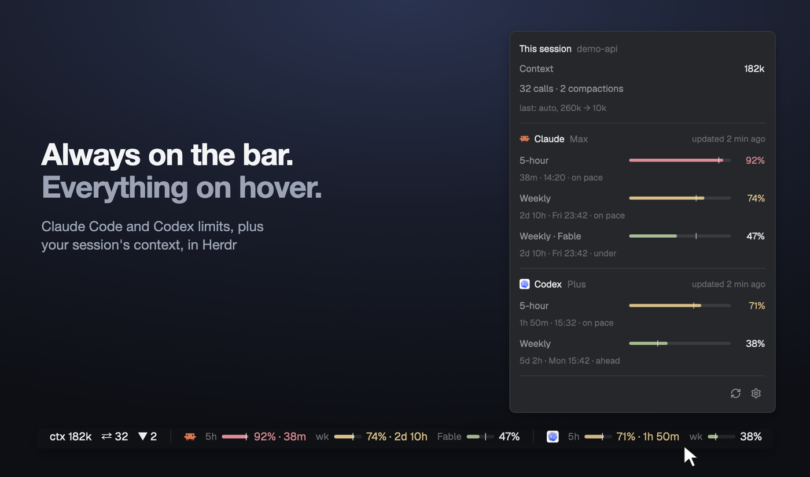

# Usage limits

Your Claude Code and Codex subscription limits in the Herdr status bar, always
in view: every limit window each one reports (5-hour, weekly, per-model weekly
such as Fable), with a bar, a pace tick, the percent used and, when it gets
tight, the time to reset. Click it to choose which providers and windows show.
It never reads a token.



## What you see

- A block at the right end of the status bar (28px high, `chrome` background,
  1px `border` top line, text 11.8px `muted`), sized by weight next to
  `workspace-status`.
- One group per provider, Claude first, then Codex; a 1×14px `border` divider
  between groups. A group: the program icon (`icons/claude.svg`,
  `icons/codex.svg`, 13px), then one segment per window:
  - a dim label (10.5px): `5h`, `wk`, `Fable`, …;
  - a 30×4px bar, track `border`, fill = percent used;
  - a 1×8px `foreground` tick at 75% opacity = how much of the window's time
    has passed (pace);
  - the percent in `foreground`.
- Colors by percent: under 70 `ansi2` (green), 70–89 `ansi3` (amber), 90+
  `ansi1` (red). Amber and red also color the text and add the time to reset:
  `92% · 38m`, `74% · 2d 10h`. With "Always show time to reset" ticked, green
  windows add it too.
- Hover a group: provider, plan, "updated N min ago", then one line per window
  with its long name, percent, reset time on the local clock (`resets Fri
  14:00`) and pace verdict (`ahead`, `on pace`, `under`).
- Click the block: a popup with a checkbox per provider and, under it, per
  window; "Always show time to reset" (off by default); "Refresh now" (30 s
  cooldown); a footnote on where data comes from.

## How it behaves

- Not tied to agent status (working, blocked, done, idle): limits are
  per account, not per agent.
- Fetches each shown provider at start and every 5 minutes; redraws every
  minute so countdowns and pace move. Hidden providers are not fetched.
- A provider whose CLI isn't installed is left out of the bar, greyed in the
  popup, and re-checked hourly. One that is installed but fails (offline, not
  signed in, CLI changed) stays with a dim `!` and keeps its last good reading,
  dimmed, with its age in the hover card. Before the first reading: `…`.
- Readings older than 15 minutes are dimmed (55% opacity).
- A window whose reset time has passed shows `—` until the next reading: never
  a guessed 0%.
- Narrow window: bars go first, then labels; percents and providers stay.
- Everything hidden: a small gauge icon remains, click it to bring things back.
- Choices are opt-out lists, so a new window (another model limit) or a CLI
  installed later shows up by itself.

## Built from

- Layout: clone `main` (`herdr-app do layout.clone '{"name":"main","as":"my-main"}'`)
  and replace the `status` block with a row:

  ```json
  { "id": "status-row", "type": "row", "size": { "px": 28 }, "resizable": false, "children": [
    { "id": "status", "type": "block", "size": { "weight": 1 }, "content": { "mod": "workspace-status" } },
    { "id": "usage-limits", "type": "block", "size": { "weight": 2.2 }, "min": 130,
      "content": { "mod": "usage-limits" } } ] }
  ```

  Optional presets in `content.props`: `{ "hidden": ["codex"],
  "hiddenWindows": ["claude:session"], "showResetTime": true }` (used until the person changes
  anything in the popup).
- `mods/usage-limits/`:
  - `main.js`: the only file using `gpui-kit`/`herdr`. Bar or popup by
    `props().view`; `exec`, `shared`/`setShared` (`usage-limits.state`,
    `usage-limits.prefs`, `usage-limits.refresh`), `openOverlay` (popup),
    `cx.timer.every(60 s)`, built-in `.tooltip(text)`.
  - `providers/claude.js`, `providers/codex.js`: `{ id, name, icon, helper,
    parse(text, now) → Report }`; `providers/index.js` lists them in order.
    A new provider is one more file there plus its helper.
  - `lib/`: `report.js` (shapes), `format.js` (time, colors, pace),
    `prefs.js` (opt-out lists, reset time flag), `view.js` (segments, tooltip, bar model,
    density). Pure; tested with `node --test`.
  - `helpers/claude-usage.sh`: runs `claude -p --safe-mode
    --no-session-persistence --input-format stream-json --output-format
    stream-json --verbose`, sends `{"type":"control_request",…,"request":
    {"subtype":"get_usage","skip_behaviors":true}}`, prints the
    `control_response` line (`rate_limits.limits[]`: `kind` `session` /
    `weekly_all` / `weekly_scoped` + `scope.model.display_name`, `percent`
    0–100, `resets_at` ISO 8601), kills the CLI.
  - `helpers/codex-limits.sh`: runs `codex app-server`, JSON-RPC
    `initialize` / `initialized` / `account/rateLimits/read`, prints the
    `"id":2` line (`primary`/`secondary`: `usedPercent`, `windowDurationMins`,
    `resetsAt` epoch s), kills it. Falls back to the newest `rate_limits`
    event in `~/.codex/sessions` (14 days).
  - Both helpers: exit 0 with one JSON line, 127 when the CLI isn't found,
    1 on any other failure; ~15 s timeout. `HERDR_USAGE_CLAUDE_BIN` /
    `HERDR_USAGE_CODEX_BIN` override the binaries.
- Approach for Claude's `get_usage`: credit to
  [jmalicki/herdr-mod-ai-usage](https://github.com/jmalicki/herdr-mod-ai-usage) (MIT).

## What it runs and reads

- Runs `sh`, your `claude` CLI and your `codex` CLI, each briefly, every
  5 minutes. They use their own sign-ins and talk to Anthropic / OpenAI; this
  mod makes no network requests itself.
- Reads no token or credential file. Reads `~/.codex/sessions/**/*.jsonl`
  only as a fallback.
- Sends no prompt and starts no turn: no model usage.
- Changes no Claude Code or Codex settings.

## Watch out

- `get_usage` is an internal Claude Code interface (verified on 2.1.317). If an
  update changes it, Claude shows `!` with the error instead of numbers.
- Claude's resets land a fraction of a second before the minute
  (`13:59:59.6`): round to the minute, or the hover card says 13:59.
- `sh missing.sh` exits 127 too; a test for "CLI not found" must also check
  the helper itself ran.
- Keep the stdin of `claude`/`codex` open through a FIFO and kill the CLI
  after the reply; a `sleep` holding a pipe makes every call last the sleep.
- Herdr starts programs with your login environment; the CLIs must be on
  that PATH (or use the env overrides).
- Herdr doesn't hot-reload a mod folder that is a symlink; switch layouts
  away and back after editing.
- macOS and Linux only (`sh`). Local machine only, one account per CLI.
- Labels are English.

## Done when

- `npm test` in the repo passes (parsers on recorded replies, helpers with a
  fake CLI, formatting, prefs, bar model).
- `herdr-app check ~/.config/herdr-app/mods/usage-limits` passes.
- `sh helpers/claude-usage.sh` prints a `control_response` line in ~1–2 s and
  leaves no `claude` process behind; `sh helpers/codex-limits.sh` prints an
  `"id":2` line in ~1–2 s.
- The bar shows the same numbers as Claude Code's `/usage` and Codex's
  `/status`.
- Clicking opens the popup; unticking Codex removes it from the bar and it
  stays removed after restarting Herdr.
