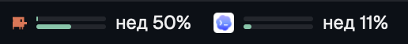

# Usage limits

A status-bar strip that shows how much of your Claude Code and Codex
subscription limits you've used: the 5-hour window and the weekly window for
each, always in view, with details on hover.



## What you see

- A 28px-high block on the right end of the status bar (250px wide), on the
  theme's `chrome` background with a 1px `border` top line, text 11.8px `muted`.
- Two groups, right-aligned, 14px apart: **Claude** then **Codex**. Each group:
  - the program icon (`icons/claude.svg`, `icons/codex.svg`), 13px;
  - two stacked bars, 44×3px, 2px apart, rounded 2px, track in `border`:
    top = 5-hour window, bottom = weekly window; fill width = percent used;
  - a label with the **worst** of the two windows: `5ч 42%` or `нед 78%`.
- Colors by percent: under 70% the fill is `ansi2` (green) and the label is
  `foreground`; 70–89% `ansi3` (yellow) for both; 90%+ `ansi1` (red), and the
  label adds the time to reset: `5ч 92% · 40м`.
- Hover (tooltip, after half a second): name and plan, both windows with
  percent and time to reset, when the data was observed and where it came from.

## How it behaves

- Data older than 30 minutes is shown at 55% opacity with a dim `устар.`.
- A window whose reset time has passed shows 0% (it has reset; we just haven't
  heard since) and the tooltip says so.
- No data: the icon and a dim `?`; the tooltip says what to set up. Before the
  first read: `…`.
- Claude is re-read every 30 s (a local file); Codex is asked every 5 min.
- Nothing is clickable. It doesn't track agent status (working, blocked, done,
  idle); it is account-level, not per agent.

## Built from

- Layout: a clone of `main` (`layout.clone {name: "main", as: "my-main"}`) where
  the `status` block (28px) becomes a row `status-row` (`px 28`,
  `resizable: false`) of `status` (`workspace-status`, unchanged) and
  `usage-limits` (`px 250`, `content: {mod: "usage-limits"}`).
- `mods/usage-limits/`:
  - `main.js`: `View`; `readTextFile`, `exec`, `home`, `theme`; `cx.timer.every`
    for polling; `.tooltip(text)` for the hover; `image()` for icons.
  - `claude-tap.sh`: put in front of the Claude Code statusline command. It
    reads the statusline JSON on stdin, writes
    `{observed_at, rate_limits}` to `~/.cache/herdr-usage-limits/claude.json`
    (atomic rename) with `jq`, then pipes stdin unchanged to the command given
    after it. Claude Code's statusline input has `rate_limits.five_hour` and
    `rate_limits.seven_day`, each `{used_percentage, resets_at}` (epoch s).
  - `codex-limits.sh`: starts `codex app-server` through a FIFO, sends
    `initialize`, `initialized`, `account/rateLimits/read`, prints the
    `"id":2` reply line and kills the server (~1.3 s). Reply:
    `result.rateLimits.primary` (5h) / `.secondary` (week), each
    `{usedPercent, windowDurationMins, resetsAt}`, plus `planType`. If that
    fails it prints `{"snapshot": <line>}`, the newest `"rate_limits"` event
    from `~/.codex/sessions/**.jsonl` (last 14 days; snake_case fields).
- Setup in `~/.claude/settings.json` (keep your own statusline after the tap):

  ```json
  "statusLine": { "type": "command",
    "command": "sh ~/.config/herdr-app/mods/usage-limits/claude-tap.sh sh ~/.claude/statusline-command.sh" }
  ```

  Without a statusline of your own, use just the tap (it then prints nothing).

## Watch out

- Privacy: it runs programs (`sh`, `codex app-server`) and reads files outside
  its folder (`~/.cache/herdr-usage-limits`, `~/.codex/sessions`). It reads no
  tokens and makes no network requests itself; Codex's app-server talks to
  OpenAI with its own login.
- Claude data is only as fresh as the last statusline render, i.e. the last
  time a Claude Code session was active. Some Claude Code versions and API-key
  (non-subscription) accounts send no `rate_limits`; then Claude shows `?`.
- Per-model limits (e.g. a separate model's weekly cap) are not shown: the
  statusline doesn't carry them.
- Don't keep a stdin pipe open with `sleep` to feed app-server: the pipeline
  then always lasts as long as the sleep. Use a FIFO and kill the server.
- `exec` runs in your login environment; `codex` must be on that PATH.
- The block can't sit before `workspace-status`'s palette hint without
  cloning that mod; it goes at the bar's right end instead.
- Labels are Russian (`5ч`, `нед`, `устар.`); change the strings in `main.js`.

## Done when

- `herdr-app check ~/.config/herdr-app/mods/usage-limits` passes.
- After any Claude Code reply, `~/.cache/herdr-usage-limits/claude.json`
  exists and the Claude bars match `/usage`.
- `sh mods/usage-limits/codex-limits.sh` prints a line with `"id":2` in about
  a second; the Codex bars match `codex` `/status`.
- Your own statusline still looks the same.
- Hovering a group shows both windows with reset times.
